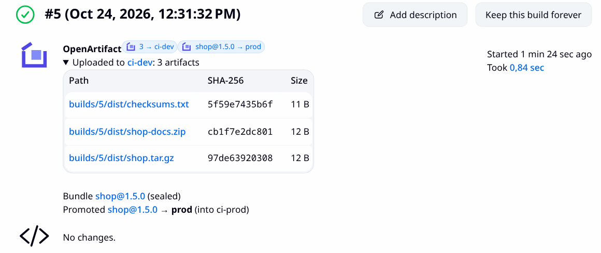
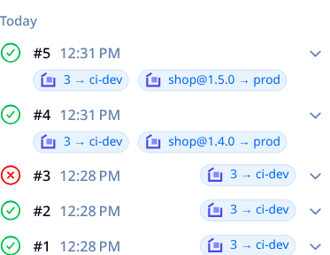

<!--
SPDX-FileCopyrightText: The OpenArtifact Authors

SPDX-License-Identifier: AGPL-3.0-or-later
-->

# OpenArtifact Jenkins plugin

Upload build artifacts to [OpenArtifact](https://github.com/openartifact/openartifact), group them into a bundle and
promote the bundle through your release stages, from a Jenkins pipeline or a freestyle job. Every build gets small
badges that link to the repository and bundle in OpenArtifact, and a summary panel listing the uploaded files with
their SHA-256.



The plugin runs the [`oa` CLI](https://openartifact.github.io/docs/integrations/cli) on the build agent and parses its
JSON output. It never talks to the REST API itself, so anything `oa upload`, `oa bundle` and `oa promote` can do, the
plugin can do, on Linux, macOS and Windows agents.

## Requirements

- Jenkins 2.568.1 or newer (LTS), which runs on Java 21 or newer
- OpenArtifact 0.10.0 or newer (the release that ships `oa upload`, `oa bundle` and `oa promote`)
- `oa` 0.10.0 or newer on the agent, or an installation the plugin downloads for you

## Setup

### 1. Add the server

*Manage Jenkins → System → OpenArtifact*:

| Field | |
| --- | --- |
| Server ID | Name used by steps (`server: 'prod'`). |
| URL | Base URL, for example `https://artifacts.example.com`. **Test connection** calls `/health`. |
| Credentials | A **Secret text** credential holding an OpenArtifact API token. A *deploy* token with read and write on the target repositories is enough; CI does not need admin rights. |

Pick a default server so steps can omit `server:`. With exactly one server configured it is used automatically.

Or with Configuration as Code:

```yaml
unclassified:
  openArtifact:
    defaultServerId: prod
    defaultInstallation: oa
    servers:
      - id: prod
        url: https://artifacts.example.com
        credentialsId: oa-prod-token

tool:
  oa:
    installations:
      - name: oa
        properties:
          - installSource:
              installers:
                - oa:
                    version: "0.10.0"
```

### 2. Provide `oa`

Either leave the default installation empty and put `oa` on the agents' `PATH`, or define an installation in *Manage
Jenkins → Tools → OpenArtifact CLI (oa)*:

- **Install from GitHub releases** downloads `oa_<version>_<os>_<arch>.tar.gz` (`.zip` on Windows) on the node that runs
  the build, checks it against the release's `SHA256SUMS` and refuses to install on a mismatch. `latest` resolves the
  newest release. An optional mirror URL serves the same two files for air-gapped setups.
- **Installation directory** points at a preinstalled `oa` (a directory containing `oa`/`oa.exe`, or the executable
  itself). Per-node locations work through the usual tool-location node property.

The plugin runs `oa --format json version` before every operation and fails with a clear message when `oa` is older
than 0.10.0.

## Pipeline steps

All three steps run on a node (`node { ... }`) and return the parsed JSON of the underlying `oa` command as a map.

### `oaUpload`

```groovy
node {
  sh './gradlew build'
  def result = oaUpload(
    server: 'prod',                  // optional when there is a default server
    repo: 'releases',
    files: 'build/libs/*.jar',       // newline- or comma-separated paths and globs (*, ?, [..], **)
    targetPath: "shop/${env.BUILD_NUMBER}/",
    flat: false,
    properties: '''
      team=core
      channel=stable
    '''
  )
  echo "uploaded ${result.uploaded.size()} files, first sha256 ${result.uploaded[0].sha256}"
}
```

Uploads to path-based repositories (raw, Maven, Ivy, sbt) and to Debian and RPM repositories. For other formats use the
format's native client.

The plugin adds the build metadata for you as artifact properties, so the artifacts can be traced back and bundled:

| Property | Value |
| --- | --- |
| `build.name` | Full job name, for example `team/shop/main` |
| `build.number` | Build number |
| `build.url` | Absolute build URL (when Jenkins has a root URL configured) |
| `vcs.revision` | `GIT_COMMIT`, when the Git plugin set it |

`properties` adds your own `key=value` pairs, one per line (blank lines and `#` comments are ignored).

### `oaBundle`

```groovy
node {
  def bundle = oaBundle(
    name: 'shop',
    version: "1.${env.BUILD_NUMBER}.0",
    pipeline: 'release',             // promotion pipeline, by name
    fromBuild: true,                 // add every artifact this build uploaded (build.name + build.number)
    artifacts: 'docs:site.zip',      // extra items, one repo:path per line
    description: 'Shop release'
  )
  echo "bundle ${bundle.bundle}@${bundle.version} is ${bundle.state}"
}
```

By default the step creates the bundle, adds the items and seals it. Set `create: false` to extend an existing bundle,
`seal: false` to keep it open, and `gpgKey:` to choose the signing key.

### `oaPromote`

```groovy
node {
  def r = oaPromote(bundle: 'shop', version: '1.7.0', stage: 'prod', notes: "build ${env.BUILD_URL}")
  echo "promoted ${r.promoted.copied} items into ${r.promoted.target_repo}"
}
```

`targetRepo:` is only needed when the pipeline stage does not fix a repository.

A complete declarative pipeline:

```groovy
pipeline {
  agent any
  stages {
    stage('Build') { steps { sh 'make dist' } }
    stage('Publish') {
      steps {
        oaUpload repo: 'ci-dev', files: 'dist/**', targetPath: "builds/${env.BUILD_NUMBER}/"
        oaBundle name: 'shop', version: "1.${env.BUILD_NUMBER}.0", pipeline: 'release', fromBuild: true
      }
    }
    stage('Release') {
      when { branch 'main' }
      steps { oaPromote bundle: 'shop', version: "1.${env.BUILD_NUMBER}.0", stage: 'prod' }
    }
  }
}
```

## Freestyle jobs

*Add build step* offers **Upload artifacts to OpenArtifact**, **Create an OpenArtifact bundle** and **Promote an
OpenArtifact bundle**; the upload and promote operations are also available as **post-build actions**. They take the same
fields as the pipeline steps.

## Badges and summary

Each build that talks to OpenArtifact records what it did:

- In the **build history** and on the **build page**, one badge per repository (`3 → releases`, linking to the
  repository in OpenArtifact) and one per promotion (`shop@1.7.0 → prod`, linking to the bundle page).
- The **build page summary** lists every uploaded artifact with its path (linking to the download), SHA-256 and size, the
  bundles the build created and the promotions it triggered.



Badges use plain Jenkins APIs (`BuildBadgeAction`); the Badge plugin is not required. Links are limited to `http` and
`https`. The bundle pages in the OpenArtifact UI are visible to administrators.

## Secrets

The API token reaches `oa` only through the `OA_TOKEN` environment variable of the child process, never on the command
line (so it does not show up in `ps` or in the echoed command). Everything `oa` writes is masked before it reaches the
build log, whether or not the credential is bound with `withCredentials`.

## Building and testing

```sh
mvn verify                      # unit tests, JenkinsRule tests with a fake oa, SpotBugs
mvn hpi:run                     # Jenkins on http://localhost:8080/jenkins with the plugin
src/test/integration/run.sh     # real OpenArtifact server + real oa (needs docker, curl, jq)
```

`run.sh` starts Postgres and the OpenArtifact release image, creates repositories, a promotion pipeline and a non-admin
CI user with a deploy token, then runs `OaIntegrationTest` (`mvn -Pintegration verify`) through a Jenkins pipeline.
Use `OA_VERSION` to pick the release, or `OA_IT_SERVER_BIN` and `OA_IT_OA_BIN` to test local binaries. In CI it runs as the
*Integration* workflow (manual and weekly), because it needs an OpenArtifact release that ships the CI commands.

## Contributing

Pull requests welcome. Every file carries an SPDX header ([REUSE](https://reuse.software)); `reuse lint` runs in CI.

## License

AGPL-3.0-or-later. The OpenArtifact mark in `src/main/webapp/images/` is CC-BY-SA-4.0.
